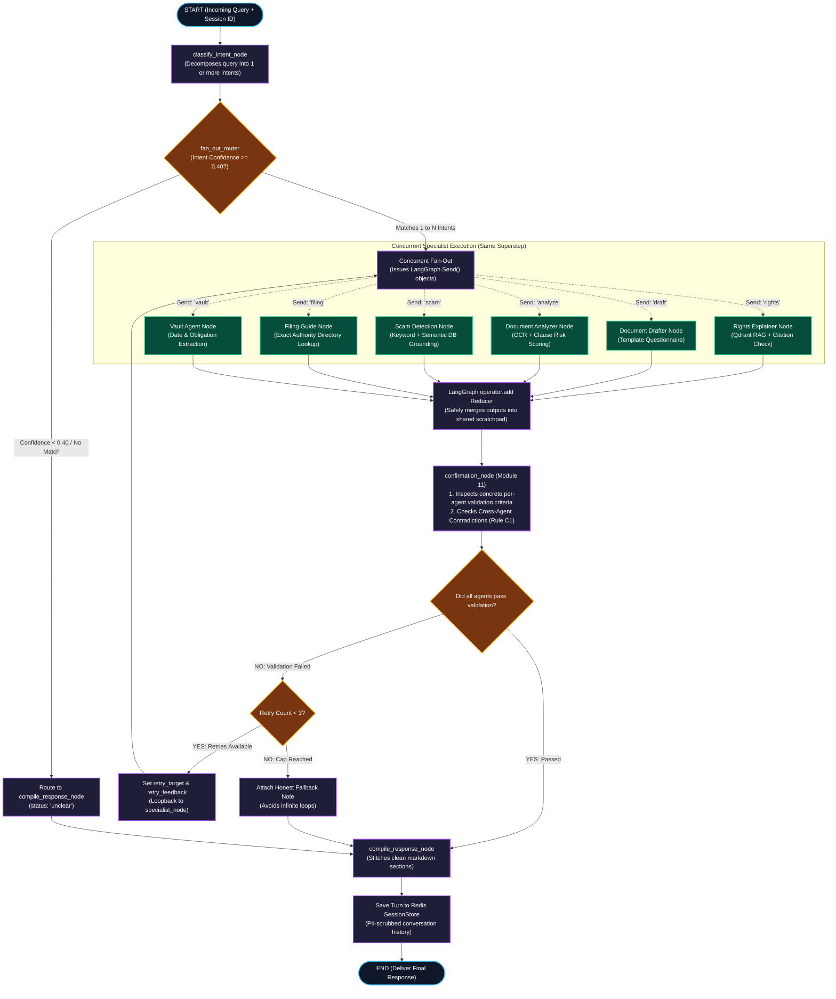
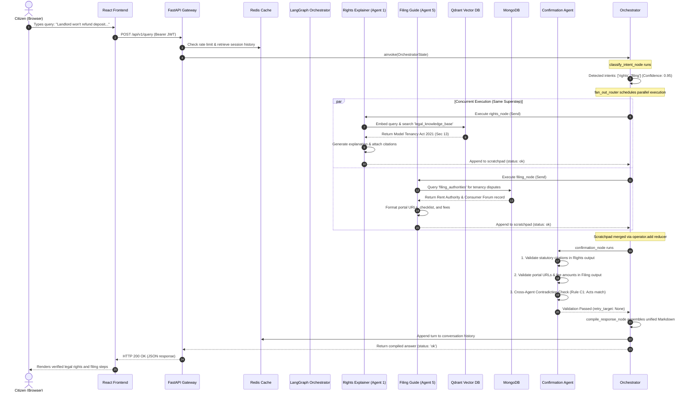

# LEXIS — Comprehensive System Architecture & Tech Stack Report

**Project Title:** Autonomous Multi-Agent Legal Aid System for Indian Citizens  
**Document Type:** Technical Architecture, Technology Stack & Unified Multi-Agent Flow Specification  
**Location in Repository:** `docs/architecture/SYSTEM_ARCHITECTURE_AND_TECH_STACK.md`  

---

## 1. Executive Summary & Database Analysis: MongoDB vs. Firebase

### The Current Reality of the Codebase
There is a common misunderstanding that Firebase replaced MongoDB in this project. **This is not what happened.**

* **MongoDB is 100% the primary database** of LEXIS. All business collections—`users`, `user_drafts`, `vault_documents`, `vault_deadlines`, `scam_patterns`, `filing_authorities`, and `reflection_logs`—are stored in MongoDB via the asynchronous **Motor** driver (`backend/db/database.py`).
* **Firebase is used exclusively for Phone OTP Authentication** on the client (`frontend/src/services/firebase.js`) and verified once on the backend (`backend/services/auth/firebase_service.py`).
* Once the user verifies their phone number through Firebase reCAPTCHA/SMS, the backend receives the Firebase ID token, verifies its signature, upserts the citizen record in **MongoDB**, and issues standard **LEXIS JWT tokens** (Access and Refresh tokens) for all subsequent API requests.

```
Citizen Phone Login Flow:
[Citizen Browser] ──(Firebase Phone OTP)──> [Firebase Auth]
       │                                            │
       │ (Receives Firebase ID Token)              │
       ▼                                            │
[POST /api/v1/auth/verify-firebase-token] ◄─────────┘
       │
       ├──> [Backend verifies token signature via firebase-admin SDK]
       ├──> [Backend upserts user in MongoDB (`users` collection)]
       └──> [Backend issues LEXIS Access JWT + Refresh JWT]
```

### Impact Analysis: What If MongoDB Were Replaced with Firebase Firestore?

If someone were to replace MongoDB with Firebase Cloud Firestore as the primary database, the project would suffer **severe technical and financial setbacks**:

| Evaluation Criterion | MongoDB (Current Architecture) | Firebase Firestore (If Swapped) | Architectural Impact |
| :--- | :--- | :--- | :--- |
| **Asynchronous Python Concurrency** | Native async driver (**Motor**). All queries (`find_one`, `insert_one`, `update_one`) are awaited cleanly inside FastAPI's non-blocking asyncio event loop. | The official Python Firebase Admin SDK uses blocking synchronous calls, or unstable community async wrappers. | **Major Bottleneck:** Database calls would block FastAPI workers, drastically reducing server throughput and agent execution speed. |
| **Query Complexity & Filtering** | Supports rich aggregations, regular expressions (`$regex`), full-text search, and multi-field conditional filters (`$or`, `$and`). | Very strict query limitations. No native regex search, cannot do `$or` queries across different fields without multiple queries, requires composite indexes for nearly every sort/filter combination. | **Broken Functionality:** Scam keyword matching and filing authority lookups would require extensive, clumsy workarounds. |
| **Multi-Agent Cost & Billing Model** | Flat hosting cost. Runs completely **FREE** locally via Docker (`docker compose up`) and has fixed-tier hosting on MongoDB Atlas. | Pay-per-document-operation (charges per read, per write, and per delete). | **High Cost Risk:** In a multi-agent system where the scheduler checks deadlines daily, agents inspect draft states, and admin analytics scan reflection logs, Firestore read costs can spiral out of control. |
| **Local Development & Offline Testing** | Trivially containerized. Both MongoDB and Redis run in lightweight Docker containers defined in `docker-compose.yml`. | Requires Google Cloud credentials or the heavy, Java-based Firebase Local Emulator Suite. | **Developer Friction:** Team members cannot easily test or run automated unit tests offline. |
| **Vector DB (RAG) Synergy** | Sits cleanly alongside Qdrant and Redis. Document metadata and chunks maintain clear relational consistency via ObjectId / UUIDs. | Tight vendor lock-in to Google Cloud infrastructure, making hybrid deployment to Render or Railway awkward. | **Deployment Rigidity:** Limits portable cloud hosting options. |

**Verdict:** Retaining **MongoDB** as the central datastore and **Firebase** strictly as a third-party Phone OTP helper is the technically superior architecture.

---

## 2. Exhaustive Technology Stack Report

Below is the complete inventory of all libraries, frameworks, engines, and tools used across the LEXIS system, categorized by layer.

### 2.1 Frontend Client Layer (`frontend/`)

| Technology | Version / Module | Exact File References | Purpose & Architectural Justification |
| :--- | :--- | :--- | :--- |
| **React** | `^18.3.1` | `src/App.jsx`, `src/pages/*.jsx` | Component-based UI library. Powers reactive state management, interactive multi-turn drafting dialogues, and live chat message rendering. |
| **Vite** | `^5.4.8` | `vite.config.js`, `package.json` | Modern frontend build tool. Provides near-instant local server startup and Hot Module Replacement (HMR). |
| **React Router DOM** | `^6.27.0` | `src/App.jsx` | Client-side routing engine. Manages route navigation (`/chat`, `/analyzer`, `/drafter`, `/filing-guide`, `/vault`, `/admin`, `/login`, `/settings`) and role-based `ProtectedRoute` guards. |
| **Axios** | `^1.7.7` | `src/services/api.js` | Promise-based HTTP client. Features request interceptors that inject Bearer JWTs and response interceptors that perform transparent token refresh when access tokens expire. |
| **Firebase Web SDK** | `^10.14.0` | `src/services/firebase.js` | Initializes client-side Firebase Auth, renders invisible reCAPTCHA challenges, and sends SMS OTP codes to Indian phone numbers (`+91...`). |
| **Vanilla CSS** | Standard CSS3 | `src/pages/*.css`, `src/index.css` | Bespoke stylesheets implementing modern dark-mode aesthetics, responsive side-by-side contract viewers, glassmorphism card surfaces, and accessible typography without heavy UI frameworks. |

---

### 2.2 Backend Gateway & Web Framework (`backend/`)

| Technology | Version / Package | Exact File References | Purpose & Architectural Justification |
| :--- | :--- | :--- | :--- |
| **FastAPI** | `0.115.0` | `backend/main.py`, `backend/api/` | High-performance async Python framework. Handles HTTP routing, dependency injection (`Depends`), automatic OpenAPI (Swagger) generation, and lifespan lifecycle hooks. |
| **Uvicorn** | `0.32.0` | `main.py` entrypoint | High-speed ASGI web server implementing the ASGI 3.0 specification for running asynchronous Python applications. |
| **Pydantic & Pydantic-Settings** | `2.12.5` / `2.5.2` | `models/user.py`, `core/config/settings.py` | Data validation, type enforcement, serialization, and `.env` parsing. Refuses application boot if required secrets or database URIs are missing. |
| **Python-JSON-Logger** | `2.0.7` | `utils/logging.py` | Formats all standard logging calls into structured JSON strings containing timestamps, log levels, module names, and custom context for machine ingestion by the Admin Dashboard. |

---

### 2.3 Databases, Caching & Vector Search

| Technology | Version / Package | Exact File References | Purpose & Architectural Justification |
| :--- | :--- | :--- | :--- |
| **MongoDB** | Database Engine | `docker-compose.yml`, `db/database.py` | **Primary Persistent Store.** Houses all application data: citizen profiles, drafts, analysis records, verified scam patterns, filing authority directories, and vault records. |
| **Motor** | `3.6.0` (wraps `pymongo 4.9.2`) | `db/database.py` | Official asynchronous Python driver for MongoDB. Allows non-blocking database queries inside FastAPI request handlers. |
| **Redis** | In-Memory Engine | `docker-compose.yml`, `db/redis_client.py` | Fast in-memory key-value store. Manages multi-turn conversation memory (`SessionStore`), OTP rate-limiting counters, and short-lived OTP hashes. |
| **Qdrant** | `qdrant-client>=1.11.0` | `db/qdrant_client.py`, `services/rag/` | Vector database for similarity search. Stores high-dimensional vector embeddings of official Indian statutes and verified scam patterns for sub-second semantic retrieval. |
| **FastEmbed** | `fastembed>=0.8.0` | `services/rag/embedder.py` | Local, hardware-accelerated embedding engine running the **BAAI/bge-m3** multi-lingual model. Generates 1024-dimensional dense vectors without paying per-token API costs. |

---

### 2.4 Multi-Agent Orchestration & Artificial Intelligence

| Technology | Version / Package | Exact File References | Purpose & Architectural Justification |
| :--- | :--- | :--- | :--- |
| **LangGraph** | `1.2.11` | `agents/orchestrator/agent.py`, `state.py` | **Core Multi-Agent State Machine.** Orchestrates parallel node execution (`Send`), manages shared state (`OrchestratorState`), merges concurrent agent outputs via reducers (`operator.add`), and implements self-correction loopback edges. |
| **LangChain Core** | `>=0.3.0` | `agents/orchestrator/` | Fundamental abstractions for message representations, graph building, and state schema typing. |
| **OpenAI API** | `openai>=1.109.0` | `core/llm_client/`, `agents/` | Primary LLM provider (`gpt-4o` for high-reasoning production tasks, `gpt-4o-mini` for development). Used for intent routing, legal synthesis, and risk rewriting. |
| **Google GenAI** | `google-genai==2.22.0` | `core/config/settings.py` | Alternate high-throughput LLM provider (`gemini-3.6-flash`) for rapid document extraction, translation, and date identification. |
| **Tenacity** | `9.0.0` | `services/rag/`, `agents/` | Declarative retry library with exponential backoff and jitter, shielding the application from transient LLM rate limits and network drops. |

---

### 2.5 Document Processing, OCR & Document Export

| Technology | Version / Package | Exact File References | Purpose & Architectural Justification |
| :--- | :--- | :--- | :--- |
| **PyMuPDF (`fitz`)** | `>=1.24.0` | `services/ocr/extractor.py` | Lightning-fast digital PDF text extractor. Bypasses OCR when PDFs contain native digital text layers. |
| **pytesseract** | `>=0.3.13` | `services/ocr/extractor.py` | Python wrapper for Google's Tesseract-OCR engine. Extracts text from scanned contracts, photocopied notices, and image uploads. |
| **Pillow (PIL)** | `>=10.0.0` | `services/ocr/extractor.py` | Image processing library. Handles image pre-processing, contrast enhancement, and formatting before OCR extraction. |
| **ReportLab** | `>=4.0.0` | `services/filing/export_pdf.py` | Programmatic PDF generation engine. Assembles court-admissible formatted PDFs with headers, margins, and signature blocks for RTI and legal notices. |
| **python-docx** | `>=1.0.0` | `services/filing/export_docx.py` | Microsoft Word (`.docx`) file generator. Creates editable document files for citizens to customize on their local computers. |

---

### 2.6 Background Schedulers & External Integrations

| Technology | Version / Package | Exact File References | Purpose & Architectural Justification |
| :--- | :--- | :--- | :--- |
| **APScheduler** | `3.10.4` | `services/vault/scheduler.py` | Advanced Python Scheduler. Runs background cron schedules (daily at 09:00 AM) to autonomously scan MongoDB for document expiry dates and trigger proactive warnings. |
| **Brevo REST API v3** | HTTP REST Client (`httpx`) | `services/notifications/email.py` | Transactional email delivery service. Delivers email OTP login codes and sends proactive legal deadline reminder emails. |

---

### 2.7 Security, Cryptography & Access Control

| Technology | Version / Package | Exact File References | Purpose & Architectural Justification |
| :--- | :--- | :--- | :--- |
| **Cryptography** | `43.0.1` | `security/vault_crypto.py` | Implements **AES-256-GCM** authenticated symmetric encryption at rest for sensitive citizen documents stored on disk. |
| **Python-JOSE** | `3.3.0` | `services/auth/jwt_service.py` | JSON Web Token (JWT) encoding, decoding, and signature verification with HMAC-SHA256. |
| **SlowAPI** | `0.1.9` | `security/api_hardening.py` | Rate limiter implementing the token-bucket algorithm to defend authentication endpoints against brute-force attacks. |
| **Prompt Injection Guards** | Custom Regex & Heuristics | `security/prompt_injection_defense.py` | Pre-execution sanitization layer that detects and blocks adversarial prompt hijacking attempts before prompts reach LLMs. |

---

## 3. Deep Dive: The 7 Specialist & Coordination Agents

LEXIS achieves high reliability through domain specialization. Each agent has an isolated responsibility:

```
┌────────────────────────────────────────────────────────────────────────┐
│                        LEXIS AGENT SPECIALIZATION                      │
├──────────────────────────┬─────────────────────────────────────────────┤
│ 1. Rights Explainer      │ Grounded RAG legal rights explanations      │
│ 2. Document Drafter      │ Multi-turn questionnaire & legal drafting   │
│ 3. Document Analyzer     │ OCR clause splitting & risk classification  │
│ 4. Scam Detection        │ DB-grounded cyber fraud pattern alerts      │
│ 5. Filing Guide          │ Deterministic exact-match authority lookup  │
│ 6. Vault & Deadline      │ AES-256-GCM storage & proactive auto-actions│
│ 7. Confirmation Agent    │ Self-correction reviewer & contradiction QA │
└──────────────────────────┴─────────────────────────────────────────────┘
```

1. **Rights Explainer Agent (`agents/rights_agent/`):**
   * Employs Retrieval-Augmented Generation (RAG).
   * Queries the Qdrant `legal_knowledge_base` using BGE-M3 embeddings.
   * Enforces a strict similarity threshold. If no official statutory chunk is found above confidence, it refuses to guess to prevent hallucination.
   * Performs mandatory citation verification (must cite specific Indian Acts and sections).

2. **Document Drafter Agent (`agents/document_drafter/`):**
   * State machine managing multi-turn questionnaires.
   * Iteratively prompts the citizen for essential facts (e.g., PIO department name, deposit amount, date of dispute).
   * Populates legally sound templates (RTI Application, Consumer Complaint, Legal Notice).
   * Exports finalized documents into PDF and DOCX formats.

3. **Document Analyzer Agent (`agents/document_analyzer/`):**
   * Ingests uploaded agreements, contracts, or notices.
   * Executes dual-mode OCR (PyMuPDF for digital PDFs, Tesseract OCR for scanned images).
   * Deconstructs documents into independent legal clauses.
   * Categorizes each clause by risk level: 🟢 **Green** (standard/safe), 🟡 **Yellow** (unfavorable/restrictive), 🔴 **Red** (onerous/unlawful).
   * Generates bilingual plain-language translations in English and Hindi.

4. **Scam Detection Engine (`agents/scam_detection/`):**
   * Two-layer detection pipeline: Layer 1 is a rapid Regex/Keyword fast path; Layer 2 is a Qdrant semantic search.
   * Safety Invariant: Alerts are **100% grounded in verified MongoDB records**. The LLM is used only for text formatting; it is forbidden from inventing facts about scams or legal consequences.

5. **Complaint Filing Guide Agent (`agents/filing_guide/`):**
   * Provides verified government authority names, official portal URLs, statutory fee schedules, and required filing checklists.
   * **Zero-Hallucination Architecture:** Performs exact-match lookups against the MongoDB `filing_authorities` collection.
   * Seamless handoff from the Document Drafter: accepts a `draft_id` and automatically routes the citizen without re-entry.

6. **Vault & Deadline Agent (`agents/vault_deadline/`):**
   * Stores files encrypted with AES-256-GCM on disk.
   * Extracts deadline-sensitive dates from OCR text with confidence scoring.
   * **Autonomous Proactive Execution:** Controlled by APScheduler. At 30, 15, and 3 days before an agreement or notice deadline, it automatically wakes up, calls the Document Drafter to generate the next-step letter, and sends an email notification to the citizen.

7. **Confirmation Agent (`agents/confirmation_agent/`):**
   * Acts as the internal Quality Assurance reviewer before any response reaches the citizen.
   * Validates specialist outputs against concrete rules (statutory citations, template completeness, DB grounding).
   * **Cross-Agent Contradiction Detection (Rule C1):** Checks whether parallel agents cited conflicting legal statutes.
   * **Bounded Self-Correction Loop:** Routes failing outputs back to the specialist agent with corrective feedback (capped at 3 retries to prevent infinite loops).

---

## 4. Complete System Architecture & Flow Diagrams

### Diagram 1: High-Level System Architecture & Component Interactions

This diagram illustrates how client requests traverse the API gateway, interact with databases, trigger the multi-agent graph, and interface with background services.

```mermaid
flowchart TD
    %% Styling Classes
    classDef clientStyle fill:#1e293b,stroke:#38bdf8,stroke-width:2px,color:#f8fafc;
    classDef gatewayStyle fill:#0f172a,stroke:#818cf8,stroke-width:2px,color:#f8fafc;
    classDef dataStyle fill:#14532d,stroke:#4ade80,stroke-width:2px,color:#f0fdf4;
    classDef aiStyle fill:#3b0764,stroke:#c084fc,stroke-width:2px,color:#faf5ff;
    classDef workerStyle fill:#7c2d12,stroke:#fb923c,stroke-width:2px,color:#fff7ed;

    %% Client Layer
    subgraph Client_Layer ["Client & Frontend Application (React 18 + Vite)"]
        Browser["Citizen Web Browser / Mobile Device"]:::clientStyle
        ReactApp["React 18 SPA (React Router, Axios, Custom CSS)"]:::clientStyle
        FirebaseAuth["Firebase Web SDK (Phone Auth & reCAPTCHA)"]:::clientStyle
        
        Browser <-->|HTTP / DOM Interactions| ReactApp
        ReactApp <-->|Invisible reCAPTCHA & SMS OTP| FirebaseAuth
    end

    %% API Gateway Layer
    subgraph Gateway_Layer ["Backend API Gateway (FastAPI on Uvicorn)"]
        FastAPI["FastAPI Application Gateway (/api/v1)"]:::gatewayStyle
        AuthMiddleware["JWT Bearer Authentication & RBAC Guard"]:::gatewayStyle
        RateLimiter["SlowAPI / Redis-Keyed Rate Limiter"]:::gatewayStyle
        UploadService["Secure File Storage & Magic-Byte Validator"]:::gatewayStyle

        ReactApp <-->|REST Requests + Bearer JWT| FastAPI
        FastAPI --- AuthMiddleware
        FastAPI --- RateLimiter
        FastAPI --- UploadService
    end

    %% Persistence & Cache Layer
    subgraph Data_Layer ["Data Persistence, Caching & Vector DB"]
        Mongo[("MongoDB Engine\n• users\n• user_drafts\n• vault_documents\n• scam_patterns\n• filing_authorities\n• reflection_logs")]:::dataStyle
        Redis[("Redis In-Memory Cache\n• Session Memory\n• OTP Counters\n• Rate-Limit Windows")]:::dataStyle
        Qdrant[("Qdrant Vector DB\n• legal_knowledge_base\n• scam_patterns")]:::dataStyle
        EncryptedDisk[("Encrypted Local Disk\n• AES-256-GCM Vault Files")]:::dataStyle

        FastAPI <-->|Motor Async Driver| Mongo
        FastAPI <-->|redis.asyncio Driver| Redis
        FastAPI <-->|qdrant-client| Qdrant
        UploadService <-->|vault_crypto.py| EncryptedDisk
    end

    %% LangGraph Orchestration Layer
    subgraph MultiAgent_Layer ["Multi-Agent State Machine (LangGraph Orchestrator)"]
        Orchestrator["LangGraph State Engine (OrchestratorState)"]:::aiStyle
        Classifier["Intent Classifier Node (OpenAI / Gemini)"]:::aiStyle
        Router{"fan_out_router (Parallel Dispatch)"}:::aiStyle
        
        FastAPI -->|Dispatches Citizen Query| Orchestrator
        Orchestrator --> Classifier
        Classifier --> Router
    end

    %% Background Autonomous Worker Layer
    subgraph Worker_Layer ["Proactive Background Execution Layer"]
        Scheduler["APScheduler Daemon (Daily at 09:00 AM)"]:::workerStyle
        EmailService["Brevo REST API v3 (Transactional Mail)"]:::workerStyle

        Scheduler -->|Queries Expiring Deadlines| Mongo
        Scheduler -->|Triggers Document Drafter| Orchestrator
        Scheduler -->|Sends Deadline Alerts| EmailService
        EmailService -->|Delivers Email to Citizen| Browser
    end
```



---

### Diagram 2: LangGraph Orchestration Flow & Self-Correction Loop

This diagram details the internal mechanics of the LangGraph state machine, highlighting intent classification, concurrent fan-out, scratchpad merging, and the Confirmation Agent retry loop.



---

### Diagram 3: Unified Multi-Agent Collaboration & Data Sharing Flow

This diagram demonstrates how specialist agents collaborate across multiple turns without asking the citizen to re-upload documents or re-explain context.

```mermaid
flowchart LR
    %% Subgraph 1: Upload & Extraction
    subgraph Step1 ["Phase 1: Ingestion & Analysis"]
        Citizen1["Citizen"] -->|Uploads PDF / Image| Analyzer["Agent 3: Document Analyzer"]
        Analyzer -->|OCR & Risk Scoring| Storage["SecureStorageService\n(AES-256-GCM Encrypted Disk)"]
        Analyzer -->|Saves Metadata & OCR Text| MongoDoc[("MongoDB: vault_documents")]
    end

    %% Subgraph 2: Storage & Proactivity
    subgraph Step2 ["Phase 2: Vault & Proactive Scheduling"]
        Storage -.-> Vault["Agent 6: Vault & Deadline Agent"]
        MongoDoc -.-> Vault
        Vault -->|Extracts Critical Expiry Dates| MongoDeadlines[("MongoDB: vault_deadlines")]
        Scheduler["APScheduler (09:00 AM Cron)"] -->|Polls Deadlines| MongoDeadlines
    end

    %% Subgraph 3: Proactive Drafting
    subgraph Step3 ["Phase 3: Proactive Document Generation"]
        Scheduler -->|At T-30 Days: Triggers Proactively| Drafter["Agent 2: Document Drafter"]
        MongoDoc -.->|Supplies Document Facts| Drafter
        Drafter -->|Assembles Renewal / Legal Notice| MongoDrafts[("MongoDB: user_drafts")]
        Scheduler -->|Sends Alert + Notice Preview| Email["Brevo Email Notification"]
        Email --> Citizen1
    end

    %% Subgraph 4: Complaint & Filing
    subgraph Step4 ["Phase 4: Seamless Complaint Filing"]
        Citizen1 -->|Clicks 'File This Notice'| Filing["Agent 5: Complaint Filing Guide"]
        MongoDrafts -.->|Reads draft_id & doc_type (No re-typing)| Filing
        Filing -->|Queries Verified Directory| MongoAuth[("MongoDB: filing_authorities")]
        Filing -->|Returns Portal URL, Checklist & Fees| Citizen1
    end
```

---

### Diagram 4: End-to-End Sequence Diagram of a Multi-Intent Citizen Query

This sequence diagram details the exact execution order, timing, and component interactions when a citizen asks:  
*"My landlord refuses to refund my ₹50,000 security deposit. Explain my rights and guide me on where to file a complaint."*



---

## 5. Architectural Summary & Verification Checklist

* [x] **No MongoDB/Firebase Conflict:** MongoDB remains the single source of truth for all records. Firebase is strictly an external SMS OTP delivery helper.
* [x] **True Multi-Agent System:** Employs LangGraph to coordinate 7 distinct agents with concurrent fan-out, reducing multi-intent latency from sequential ($T_1 + T_2$) to parallel ($\max(T_1, T_2)$).
* [x] **Self-Correction & Safety:** The Confirmation Agent validates citations and checks cross-agent contradictions with a bounded 3-retry limit to eliminate infinite loops.
* [x] **Autonomous Proactivity:** The Vault & Deadline Agent acts on the citizen's behalf without prompt initiation, drafting required letters and issuing deadline alerts through daily cron scheduling.
* [x] **Zero Information Loss:** Shared file storage (`SecureStorageService`), Redis session context, and MongoDB draft identifiers allow documents and facts to flow between agents seamlessly without asking the citizen to re-enter data.
