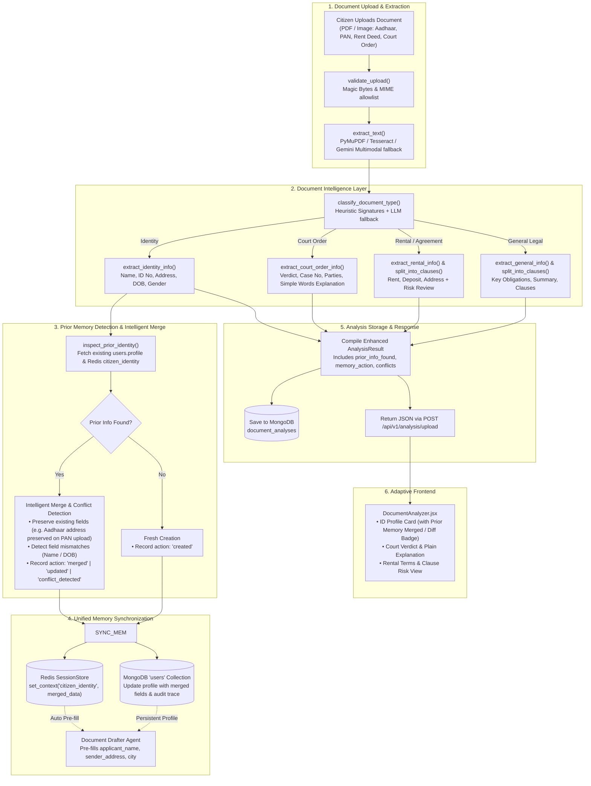

# Implementation Plan (v2.1): Intelligent Multi-Document Analyzer & Cross-Agent Memory Integration

**Document Version:** 2.1 (Harmonized with Teammate Merges + Prior Information Detection Layer)  
**Target Module:** Module 7 (Document Analyzer) with Cross-Agent Integration (Module 6 & Module 13B / 2)  
**Status:** Under Review (Ready for Execution)

---

## 1. Executive Summary & Objective

The objective of this upgrade is to transform the **LEXIS Document Analyzer Agent** from a single-purpose contract clause checker into an **Intelligent, Multi-Type Legal Document Analyzer & Extractor** that:
1. **Automatically detects any uploaded document type** (Identity Card, Rental Agreement, Court Order/Judgment, Contract, General Legal Document).
2. **Extracts essential information without asking the user questions**:
   - **Aadhaar / PAN Cards:** Extracts Full Name, ID Number, Address, Date of Birth, Gender, Father/Spouse name, Issuing Authority.
   - **Rental Agreements:** Extracts Landlord, Tenant, Rented Property Address, Monthly Rent, Security Deposit, Duration, Notice Period, Lock-in Period + Plain-language explanation + Clause risk flags.
   - **Court Judgments / Orders:** Extracts Court Name, Case/CNR Number, Decision Date, Parties, Bench/Judge, Operative Verdict/Order + Plain-Language Explanation in simple words (Bilingual English + Hindi) + Directions.
3. **Identifies Prior Information Before Saving to Unified Memory**:
   - **Pre-Save Inspection:** Checks whether citizen identity details are already stored in MongoDB (`users.profile`) or Redis session memory (`SessionStore`).
   - **Intelligent Non-Destructive Merge:** Prevents wiping out existing data (e.g. uploading a PAN card which has no address will preserve an address previously stored from Aadhaar or profile setup).
   - **Conflict & Diff Detection:** Detects and flags any discrepancies between prior profile data and newly extracted document data (e.g. name variations or different addresses) instead of silently overwriting.
4. **Persists Extracted & Merged Identity Details to Memory & Profile**:
   - Updates **Redis Session Store** (`SessionStore`) and the citizen's **MongoDB Profile** (`users.profile`).
   - Enables **Document Drafter Agent** (and other specialist agents) to automatically pre-fill applicant/sender details (Name, Address, City) so the user never has to re-type them.
5. **Delivers an Adaptive Frontend UI**:
   - Renders tailored visual cards depending on the document: ID Profile Card (with prior data diff badge), Court Verdict Banner & Summary, or Agreement Key Terms & Clause Risk Viewer.

---

## 2. Post-Merge Reverification & Alignment Analysis

Following the merge of PR #3 (Auth, User Model, Profile routes, Brevo REST API) and PR #4 (Rights Agent enhancements), the plan was reverified against the active codebase. The following alignments have been integrated:

| Area | Issue in Previous Draft | Resolved Design in v2.1 |
|---|---|---|
| **Prior Information Detection** | Unconditionally clobbered existing memory/profile without checking prior state. | **Pre-Save Inspector**: reads MongoDB `users.profile` and Redis `SessionStore.get_context()`. Identifies prior fields, detects conflicts, and non-destructively merges (preserving prior address if new doc lacks address). |
| **MongoDB User Profile Query** | Previous plan queried `{"id": user_id}`. | In MongoDB, user primary key is `_id: ObjectId(user_id)`. Querying `{"id": user_id}` fails silently. Resolved to `{"_id": ObjectId(user_id)}`. |
| **Anonymous Session Safety** | Would throw `InvalidId` when trying `ObjectId("anon:...")`. | Checks `current_user.get("role") != "anonymous"` and validates `ObjectId.is_valid()`. Anonymous users skip DB profile update without throwing errors. |
| **Date of Birth Normalization** | Aadhaar/PAN returns `DD/MM/YYYY`. Storing this raw would break `ProfileUpdateRequest` date validator (`YYYY-MM-DD`). | Extractor normalizes extracted dates to ISO `YYYY-MM-DD` for `profile.date_of_birth` while keeping original display format in `extracted_info`. |
| **User Profile Pydantic Schema** | `ProfileDocument` in [`backend/models/user.py`](file:///d:/Tejas%20Class%20Projects/LEXIS_project_structure/LEXIS/backend/models/user.py) lacked `city`, `id_verified`, `id_type`, `id_number_masked`. `GET /users/me/profile` would strip them. | Extend `ProfileDocument` with optional fields: `city: Optional[str]`, `id_verified: bool`, `id_type: Optional[str]`, `id_number_masked: Optional[str]`. |
| **Session ID on File Upload** | `POST /api/v1/analysis/upload` took only `file`, so Redis session hash `lexis:session:{session_id}` could not be identified. | Add `session_id: Optional[str] = Form(None)` to endpoint and update [`frontend/src/services/api.js`](file:///d:/Tejas%20Class%20Projects/LEXIS_project_structure/LEXIS/frontend/src/services/api.js) to pass it. |
| **Drafter Pre-Fill Question Logic** | Previous drafter logic hardcoded `first_question = questions[0]`, ignoring pre-filled answers. | Calculate `questions_answered` dynamically and set `first_question` to the **first unanswered question**, returning `prefilled_fields` list. |
| **LLM SDK Standardization** | Codebase standardizes on `google-genai` SDK (`genai.Client`). | Use `google.genai.Client(api_key=settings.GEMINI_API_KEY)` with `settings.GEMINI_MODEL_DEV` (and OpenAI fallback) across all extractors. |

---

## 3. Architecture & Data Flow



---

## 4. Detailed Component Implementation Plan

### Phase 1: User Profile Model Updates & Schema Compatibility
**Files to modify:**
- [`backend/models/user.py`](file:///d:/Tejas%20Class%20Projects/LEXIS_project_structure/LEXIS/backend/models/user.py)

**Specific Implementation:**
1. Update `ProfileDocument` in [`backend/models/user.py`](file:///d:/Tejas%20Class%20Projects/LEXIS_project_structure/LEXIS/backend/models/user.py#L59) to include:
   ```python
   class ProfileDocument(BaseModel):
       full_name: Optional[str] = None
       address: Optional[str] = None
       city: Optional[str] = None
       preferred_language: Optional[PreferredLanguage] = None
       date_of_birth: Optional[str] = None  # Expected ISO format: YYYY-MM-DD
       id_verified: bool = False
       id_type: Optional[str] = None       # "Aadhaar", "PAN"
       id_number_masked: Optional[str] = None
       profile_picture_url: Optional[str] = None
       notification_preference: NotificationPreference = NotificationPreference.SMS
   ```
2. Update `ProfileUpdateRequest` to allow `city: Optional[str] = None` so citizens can also update city manually in Settings.

---

### Phase 2: Document Intelligence Service & Extraction Prompts
**Files to create/modify:**
- Create: [`backend/services/analysis/doc_intelligence.py`](file:///d:/Tejas%20Class%20Projects/LEXIS_project_structure/LEXIS/backend/services/analysis/doc_intelligence.py)
- Modify: [`backend/agents/document_analyzer/prompts.py`](file:///d:/Tejas%20Class%20Projects/LEXIS_project_structure/LEXIS/backend/agents/document_analyzer/prompts.py)

**Specific Implementation:**
1. **Document Classification (`classify_document_type`):**
   - High-speed heuristic regex rules:
     - Aadhaar: `UIDAI`, `Unique Identification Authority`, 12-digit pattern `\d{4}\s\d{4}\s\d{4}`, `Mera Aadhaar`.
     - PAN: `Income Tax Department`, `Permanent Account Number`, `[A-Z]{5}[0-9]{4}[A-Z]`.
     - Rental Agreement: `Rent Agreement`, `Tenancy Agreement`, `Lease Deed`, `Landlord/Lessor`, `Tenant/Lessee`, `Security Deposit`.
     - Court Document: `In the High Court`, `Supreme Court`, `Petitioner`, `Respondent`, `Versus`, `Judgment`, `Order`, `Coram`, `Bail Appln`.
   - LLM fallback prompt `DOC_CLASSIFICATION_PROMPT` for ambiguous files.
2. **Specialized Extractors:**
   - **`extract_identity_info(text, doc_type)`**:
     - Deterministic regex for ID numbers, PIN codes, DOB.
     - Structured GenAI JSON parser extracting:
       ```json
       {
         "name": "Full Name",
         "id_number": "XXXX XXXX 1234",
         "id_type": "Aadhaar Card | PAN Card",
         "dob": "DD/MM/YYYY",
         "dob_iso": "YYYY-MM-DD",
         "gender": "Male | Female | Other",
         "care_of": "Father / Spouse / Parent Name",
         "address": "Full Street Address, City, State, PIN",
         "city": "City Name",
         "pin_code": "6-digit PIN",
         "issuing_authority": "UIDAI | Income Tax Dept"
       }
       ```
     - Date normalizer utility `normalize_to_iso_date(dob_str)` ensuring `dob_iso` is strictly formatted as `YYYY-MM-DD`.
   - **`extract_rental_agreement_info(text)`**:
     - Extracts: `landlord_name`, `tenant_name`, `property_address`, `monthly_rent`, `rent_due_day`, `security_deposit`, `deposit_refund_terms`, `lease_duration`, `start_date`, `end_date`, `notice_period`, `lock_in_period`, `maintenance_charges`.
     - Generates plain-language explanation of rights and core commitments.
   - **`extract_court_order_info(text)`**:
     - Extracts: `court_name`, `case_number`, `decision_date`, `bench`, `petitioner`, `respondent`, `acts_sections`.
     - Extracts **`verdict`** (e.g., *"Bail Granted"*, *"Appeal Dismissed"*, *"Injunction Allowed"*).
     - Extracts **`operative_order`** (the exact directions of the judge).
     - Generates **`plain_language_explanation`**: Translates complex legal ruling into simple everyday words in both English and Hindi.
     - Extracts **`key_actions`** (e.g., furnish bail bond within 7 days, surrender passport, appeal window).

---

### Phase 3: Prior Information Detection & Cross-Agent Memory Integration
**Files to modify:**
- [`backend/agents/document_analyzer/agent.py`](file:///d:/Tejas%20Class%20Projects/LEXIS_project_structure/LEXIS/backend/agents/document_analyzer/agent.py)
- [`backend/api/routes/analysis.py`](file:///d:/Tejas%20Class%20Projects/LEXIS_project_structure/LEXIS/backend/api/routes/analysis.py)
- [`backend/api/routes/drafts.py`](file:///d:/Tejas%20Class%20Projects/LEXIS_project_structure/LEXIS/backend/api/routes/drafts.py)
- [`frontend/src/services/api.js`](file:///d:/Tejas%20Class%20Projects/LEXIS_project_structure/LEXIS/frontend/src/services/api.js)

**Specific Implementation:**
1. **Pre-Save Prior Information Inspector (`inspect_prior_identity`)**:
   Before updating Redis or MongoDB:
   - Query MongoDB `db["users"].find_one({"_id": ObjectId(user_id)})` to get `prior_profile`.
   - Query Redis `store.get_context(session_id)` to get `prior_context.get("citizen_identity")`.
   - Check if any key identity fields (`full_name`, `address`, `city`, `date_of_birth`, `id_number`) already exist.
   - Set `prior_info_found = True` if existing data is present.

2. **Diff & Conflict Detection**:
   - Compare existing fields with newly extracted fields:
     - **Name difference:** if `prior_name` exists and does not match `new_name` (e.g., "Tejas Chaudhari" vs "Ramesh Kumar Sharma"), record in `conflicts`.
     - **DOB difference:** if `prior_dob` exists and differs from `new_dob`, record in `conflicts`.
     - **Address enrichment:** if `prior_address` exists and new doc has no address (e.g. PAN card), preserve `prior_address`.
     - **Track `changed_fields`:** list of fields that were updated or added.

3. **Intelligent Non-Destructive Merge Implementation**:
   ```python
   async def inspect_and_sync_identity(
       user_id: str,
       session_id: Optional[str],
       extracted: dict,
       db: Any,
       redis: Any = None,
   ) -> dict:
       prior_info = {}
       prior_info_found = False
       conflicts = []
       changed_fields = []

       # 1. Inspect prior MongoDB profile
       is_real_user = db is not None and user_id and not user_id.startswith("anon:")
       if is_real_user:
           from bson import ObjectId
           if ObjectId.is_valid(user_id):
               user_doc = await db["users"].find_one({"_id": ObjectId(user_id)})
               if user_doc and user_doc.get("profile"):
                   prof = user_doc["profile"]
                   if prof.get("full_name") or prof.get("address"):
                       prior_info_found = True
                       prior_info = {
                           "name": prof.get("full_name"),
                           "address": prof.get("address"),
                           "city": prof.get("city"),
                           "dob": prof.get("date_of_birth"),
                           "id_type": prof.get("id_type"),
                           "id_number": prof.get("id_number_masked"),
                       }

       # 2. Inspect prior Redis context if not found in Mongo
       store = get_session_store(redis_client=redis)
       if session_id and not prior_info_found:
           ctx = await store.get_context(session_id)
           if ctx.get("citizen_identity"):
               prior_info_found = True
               prior_info = ctx["citizen_identity"]

       # 3. Detect conflicts & merge non-destructively
       merged = dict(extracted)
       action = "created"

       if prior_info_found:
           action = "merged"
           # Conflict check: Name mismatch
           prior_name = (prior_info.get("name") or "").strip()
           new_name = (extracted.get("name") or "").strip()
           if prior_name and new_name and prior_name.lower() != new_name.lower():
               conflicts.append({
                   "field": "name",
                   "prior": prior_name,
                   "extracted": new_name,
                   "description": f"Name on document ('{new_name}') differs from existing profile name ('{prior_name}')."
               })

           # Conflict check: DOB mismatch
           prior_dob = (prior_info.get("dob") or "").strip()
           new_dob = (extracted.get("dob_iso") or extracted.get("dob") or "").strip()
           if prior_dob and new_dob and prior_dob != new_dob:
               conflicts.append({
                   "field": "date_of_birth",
                   "prior": prior_dob,
                   "extracted": new_dob,
                   "description": f"Date of birth on document ('{new_dob}') differs from existing profile ('{prior_dob}')."
               })

           # Non-destructive address preservation:
           # If new doc lacks address (e.g., PAN card), preserve prior address
           if not extracted.get("address") and prior_info.get("address"):
               merged["address"] = prior_info["address"]
           if not extracted.get("city") and prior_info.get("city"):
               merged["city"] = prior_info["city"]

           # Track changed fields
           for k, v in merged.items():
               if v and v != prior_info.get(k):
                   changed_fields.append(k)

           if conflicts:
               action = "conflict_detected"
           elif changed_fields:
               action = "updated" if set(changed_fields) == set(merged.keys()) else "merged"

       # 4. Synchronize to Redis SessionStore
       if session_id:
           updates = {
               "citizen_identity": merged,
               "applicant_name": merged.get("name", ""),
               "sender_name": merged.get("name", ""),
               "complainant_name": merged.get("name", ""),
               "applicant_address": merged.get("address", ""),
               "sender_address": merged.get("address", ""),
               "complainant_address": merged.get("address", ""),
               "city": merged.get("city", ""),
               "forum_city": merged.get("city", ""),
           }
           await store.set_context(session_id, updates)

       # 5. Synchronize to MongoDB User Profile
       if is_real_user and ObjectId.is_valid(user_id):
           update_dict = {
               "profile.full_name": merged.get("name"),
               "profile.address": merged.get("address"),
               "profile.city": merged.get("city"),
               "profile.id_verified": True,
               "profile.id_type": merged.get("id_type"),
               "profile.id_number_masked": merged.get("id_number"),
               "profile.updated_at": datetime.now(timezone.utc).isoformat(),
           }
           dob_iso = merged.get("dob_iso")
           if dob_iso:
               update_dict["profile.date_of_birth"] = dob_iso
           await db["users"].update_one({"_id": ObjectId(user_id)}, {"$set": update_dict})

       return {
           "memory_saved": True,
           "prior_info_found": prior_info_found,
           "memory_action": action,
           "prior_info": prior_info if prior_info_found else None,
           "changed_fields": changed_fields,
           "conflicts": conflicts,
           "merged_identity": merged,
       }
   ```

4. **Auto Pre-fill in Document Drafter (`POST /api/v1/drafts/session`)**:
   - In [`backend/api/routes/drafts.py`](file:///d:/Tejas%20Class%20Projects/LEXIS_project_structure/LEXIS/backend/api/routes/drafts.py#L78):
     Check if user has stored identity in `db["users"]` (`profile.full_name`, `profile.address`, `profile.city`).
     If found:
     - RTI Application: auto-populate `applicant_name`, `applicant_address`, `city`.
     - Legal Notice: auto-populate `sender_name`, `sender_address`, `city`.
     - Consumer Complaint: auto-populate `complainant_name`, `complainant_address`, `forum_city`.
   - Compute `first_question` dynamically:
     ```python
     unanswered_q = None
     for q in template_info["questions"]:
         if q["key"] not in collected_answers or not str(collected_answers[q["key"]]).strip():
             unanswered_q = q["question"]
             break
     ```
   - Return `prefilled_fields: List[str]` in `DraftSessionResponse` to inform UI.

---

### Phase 4: OCR Service & Gemini Vision Fallback
**Files to modify:**
- [`backend/services/ocr/extractor.py`](file:///d:/Tejas%20Class%20Projects/LEXIS_project_structure/LEXIS/backend/services/ocr/extractor.py)

**Specific Implementation:**
1. In `_extract_from_image` and `_extract_from_pdf`:
   - If local OCR yields empty/unintelligible text and `GEMINI_API_KEY` is present:
   - Call Gemini Vision model (`gemini-2.5-flash` or `gemini-3.6-flash`) with image bytes:
     Prompt: `"Extract all printed and handwritten text verbatim from this legal or identity document. Do not summarize or add commentary."`
   - Returns high-fidelity text even on Windows setups without local Tesseract installed.

---

### Phase 5: API Response Schema Enhancement
**Files to modify:**
- [`backend/agents/document_analyzer/agent.py`](file:///d:/Tejas%20Class%20Projects/LEXIS_project_structure/LEXIS/backend/agents/document_analyzer/agent.py)
- [`backend/api/routes/analysis.py`](file:///d:/Tejas%20Class%20Projects/LEXIS_project_structure/LEXIS/backend/api/routes/analysis.py)

**Specific Implementation:**
1. Enrich `AnalysisResult`:
   - `document_category`: `"identity_document"` | `"court_document"` | `"agreement_contract"` | `"general_legal"`
   - `document_type`: `"aadhaar_card"` | `"pan_card"` | `"rental_agreement"` | `"court_judgment"` | `"contract"` | `"other"`
   - `document_title`: Human-readable label (e.g., *"Aadhaar Card (UIDAI)"*)
   - `extracted_info`: Structured key-value dictionary
   - `plain_language_summary`: Simple explanation (English + Hindi)
   - `key_actions`: Actionable checklist or directions
   - `memory_saved`: Boolean indicating whether details were saved to user profile / session memory
   - **Prior memory metadata:**
     - `prior_info_found`: Boolean (`True` if previous identity existed)
     - `memory_action`: `"created"` | `"merged"` | `"updated"` | `"conflict_detected"`
     - `prior_info`: Dictionary of prior values (or null)
     - `changed_fields`: List of updated field names
     - `conflicts`: List of detected contradictions
2. Backward compatibility: Retain `total_clauses`, `green_count`, `yellow_count`, `red_count`, `clauses` so existing tests and clients continue working without disruption.

---

### Phase 6: Adaptive Frontend UI & Design
**Files to modify:**
- [`frontend/src/services/api.js`](file:///d:/Tejas%20Class%20Projects/LEXIS_project_structure/LEXIS/frontend/src/services/api.js)
- [`frontend/src/pages/DocumentAnalyzer.jsx`](file:///d:/Tejas%20Class%20Projects/LEXIS_project_structure/LEXIS/frontend/src/pages/DocumentAnalyzer.jsx)
- [`frontend/src/pages/DocumentAnalyzer.css`](file:///d:/Tejas%20Class%20Projects/LEXIS_project_structure/LEXIS/frontend/src/pages/DocumentAnalyzer.css)

**Specific Implementation:**
1. **API Client (`api.js`)**:
   - Update `uploadDocumentForAnalysis(file, sessionId)` to append `session_id` to FormData if present.
2. **Adaptive Views in `DocumentAnalyzer.jsx`**:
   - **View 1 — Identity Profile Card (Aadhaar / PAN)**:
     - Styled government credential card with verified hologram chip.
     - Full Name, Masked ID Number with 1-click Copy button.
     - Address with location pin icon.
     - DOB, Gender, Care-Of / Father Name.
     - **Prior Memory Status Banner:**
       - *Fresh Creation:* `"✓ Identity details saved to your profile and memory. The Document Drafter will use these automatically."`
       - *Intelligently Merged:* `"ℹ️ Prior Profile Found: Details were merged non-destructively. Existing address was preserved."`
       - *Conflict Detected:* `"⚠️ Note: Document name ('{extracted}') differs from existing profile ('{prior}'). Verified ID updated."`
     - Quick Action Button: *"Start Document Draft with these details →"* (navigates to `/drafter`).
   - **View 2 — Court Judgment & Verdict Card**:
     - Large Verdict Banner:
       - 🟢 Bail / Relief Granted
       - 🔴 Appeal / Petition Dismissed
       - 🟡 Directions Issued / Remanded
     - Case metadata pill bar: Court, Case No., Date, Bench.
     - Bilingual Card: **"In Simple Words / सरल शब्दों में"**.
     - Compliance checklist of operative directions.
   - **View 3 — Rental Agreement & Contract Card**:
     - Key Terms Grid: Landlord, Tenant, Rented Property, Monthly Rent, Security Deposit, Notice Period, Lock-in Period.
     - Tab switcher: **"Key Terms & Summary"** ↔ **"Clause Risk Analysis"** (Green, Caution, Red clause viewer).

---

### Phase 7: Testing & Quality Assurance
**Files to modify:**
- [`backend/tests/unit/test_document_analyzer.py`](file:///d:/Tejas%20Class%20Projects/LEXIS_project_structure/LEXIS/backend/tests/unit/test_document_analyzer.py)

**Specific Tests to Add:**
1. `test_aadhaar_card_extraction()`: Verifies Name, 12-digit Aadhaar number, Address, and DOB ISO normalization.
2. `test_pan_card_extraction()`: Verifies Name, PAN format `[A-Z]{5}[0-9]{4}[A-Z]`, Father's Name, DOB.
3. `test_prior_info_detection_and_non_destructive_merge()`: Verifies that prior address is preserved when uploading a PAN card (which lacks address).
4. `test_prior_info_conflict_detection()`: Verifies that name or DOB discrepancies are detected and reported in `conflicts`.
5. `test_identity_saves_to_memory_and_profile()`: Verifies Redis session context and MongoDB user profile update with `ObjectId`.
6. `test_anonymous_user_skips_profile_update_safely()`: Verifies no crash when anonymous user uploads ID.
7. `test_document_drafter_auto_prefills_identity()`: Verifies Document Drafter initializes with pre-filled name/address and advances to first unanswered question.
8. `test_rental_agreement_extraction()`: Verifies Landlord, Tenant, Address, Rent, Deposit, and plain summary.
9. `test_court_judgment_extraction()`: Verifies Court Name, Case Number, Parties, Verdict, and simple words explanation.
10. **Regression Guarantee:** Run all 9 existing unit tests in `test_document_analyzer.py` to ensure 100% pass rate.

---

## 5. Exact Data Schemas

### 5.1 Identity Card Response Schema (with Prior Memory Metadata)
```json
{
  "status": "ok",
  "document_category": "identity_document",
  "document_type": "aadhaar_card",
  "document_title": "Aadhaar Card (UIDAI)",
  "memory_saved": true,
  "prior_info_found": true,
  "memory_action": "merged",
  "prior_info": {
    "name": "Ramesh Kumar Sharma",
    "address": "Flat 402, Green Valley Apts, Sector 62, Noida, UP",
    "city": "Noida",
    "dob": "1985-08-15",
    "id_type": "PAN",
    "id_number": "ABCDE1234F"
  },
  "changed_fields": ["id_type", "id_number", "issuing_authority"],
  "conflicts": [],
  "extracted_info": {
    "name": "Ramesh Kumar Sharma",
    "id_number": "XXXX XXXX 9012",
    "id_type": "Aadhaar",
    "dob": "15/08/1985",
    "dob_iso": "1985-08-15",
    "gender": "Male",
    "care_of": "Suresh Sharma",
    "address": "Flat 402, Green Valley Apts, Sector 62, Noida, Gautam Buddha Nagar, Uttar Pradesh - 201301",
    "city": "Noida",
    "pin_code": "201301",
    "issuing_authority": "Unique Identification Authority of India (UIDAI)"
  },
  "plain_language_summary": "Verified Indian National Identity Card (Aadhaar). Identity details for Ramesh Kumar Sharma have been merged with your existing profile and session memory.",
  "total_clauses": 0,
  "green_count": 0,
  "yellow_count": 0,
  "red_count": 0,
  "clauses": []
}
```

### 5.2 Court Judgment Response Schema
```json
{
  "status": "ok",
  "document_category": "court_document",
  "document_type": "court_judgment",
  "document_title": "High Court of Delhi — Bail Application No. 1420/2026",
  "extracted_info": {
    "court_name": "High Court of Delhi at New Delhi",
    "case_number": "BAIL APPLN. 1420/2026",
    "decision_date": "04 October 2026",
    "bench": "Hon'ble Mr. Justice Amit Sharma",
    "petitioner": "Vikas Malhotra",
    "respondent": "State (NCT of Delhi)",
    "acts_sections": ["Section 439 Cr.P.C.", "Sections 420/406 IPC"],
    "verdict": "BAIL GRANTED",
    "operative_order": "The applicant is directed to be released on regular bail upon furnishing a personal bond of ₹50,000 with one surety of the like amount."
  },
  "plain_language_summary": "सरल शब्दों में अदालत का फैसला: उच्च न्यायालय ने विकास मल्होत्रा की नियमित जमानत याचिका स्वीकार कर ली है।\nIn Simple Words: The High Court has granted regular bail to Vikas Malhotra. He will be released once a personal bail bond of ₹50,000 and one guarantor are submitted in the trial court.",
  "key_actions": [
    "Arrange one local guarantor for ₹50,000.",
    "Submit bail bonds before the Trial Court / Magistrate.",
    "Surrender passport to the Investigating Officer within 7 days."
  ],
  "total_clauses": 0,
  "clauses": []
}
```

### 5.3 Rental Agreement Response Schema
```json
{
  "status": "ok",
  "document_category": "agreement_contract",
  "document_type": "rental_agreement",
  "document_title": "Residential Tenancy Agreement",
  "extracted_info": {
    "landlord_name": "Satish Verma",
    "tenant_name": "Ramesh Kumar Sharma",
    "property_address": "House No. 12B, Indiranagar, Bengaluru, Karnataka - 560038",
    "monthly_rent": "₹28,000 / month (due by 5th)",
    "security_deposit": "₹1,50,000 (Refundable)",
    "lease_duration": "11 Months",
    "notice_period": "1 Month",
    "lock_in_period": "6 Months"
  },
  "plain_language_summary": "This is an 11-month rent agreement between Satish Verma and Ramesh Kumar Sharma for premises in Indiranagar, Bengaluru. Rent is ₹28,000/month. Under Indian tenancy laws, your security deposit must be refunded within 30 days of vacating.",
  "total_clauses": 12,
  "green_count": 10,
  "yellow_count": 1,
  "red_count": 1,
  "clauses": []
}
```

---

## 6. Implementation Checklist & Order of Execution

1. [ ] **Step 1:** Extend `ProfileDocument` in [`backend/models/user.py`](file:///d:/Tejas%20Class%20Projects/LEXIS_project_structure/LEXIS/backend/models/user.py) with `city`, `id_verified`, `id_type`, `id_number_masked`.
2. [ ] **Step 2:** Create [`backend/services/analysis/doc_intelligence.py`](file:///d:/Tejas%20Class%20Projects/LEXIS_project_structure/LEXIS/backend/services/analysis/doc_intelligence.py) with document categorization, specialized extractors, and DOB normalization.
3. [ ] **Step 3:** Update [`backend/agents/document_analyzer/prompts.py`](file:///d:/Tejas%20Class%20Projects/LEXIS_project_structure/LEXIS/backend/agents/document_analyzer/prompts.py) with structured classification, entity extraction, and bilingual plain-language prompts.
4. [ ] **Step 4:** Enhance [`backend/services/ocr/extractor.py`](file:///d:/Tejas%20Class%20Projects/LEXIS_project_structure/LEXIS/backend/services/ocr/extractor.py) with Gemini Multimodal Vision fallback.
5. [ ] **Step 5:** Implement `inspect_prior_identity` and non-destructive merge logic in [`backend/agents/document_analyzer/agent.py`](file:///d:/Tejas%20Class%20Projects/LEXIS_project_structure/LEXIS/backend/agents/document_analyzer/agent.py).
6. [ ] **Step 6:** Update [`backend/api/routes/analysis.py`](file:///d:/Tejas%20Class%20Projects/LEXIS_project_structure/LEXIS/backend/api/routes/analysis.py) to accept optional `session_id: Form` and persist enriched metadata & prior memory audit to MongoDB.
7. [ ] **Step 7:** Update [`backend/api/routes/drafts.py`](file:///d:/Tejas%20Class%20Projects/LEXIS_project_structure/LEXIS/backend/api/routes/drafts.py) so Document Drafter auto-prefills saved identity fields and advances to first unanswered question.
8. [ ] **Step 8:** Update [`frontend/src/services/api.js`](file:///d:/Tejas%20Class%20Projects/LEXIS_project_structure/LEXIS/frontend/src/services/api.js) to pass `session_id`.
9. [ ] **Step 9:** Update [`frontend/src/pages/DocumentAnalyzer.jsx`](file:///d:/Tejas%20Class%20Projects/LEXIS_project_structure/LEXIS/frontend/src/pages/DocumentAnalyzer.jsx) and [`DocumentAnalyzer.css`](file:///d:/Tejas%20Class%20Projects/LEXIS_project_structure/LEXIS/frontend/src/pages/DocumentAnalyzer.css) with adaptive views and prior memory merge/diff banner.
10. [ ] **Step 10:** Add comprehensive unit tests in [`backend/tests/unit/test_document_analyzer.py`](file:///d:/Tejas%20Class%20Projects/LEXIS_project_structure/LEXIS/backend/tests/unit/test_document_analyzer.py) covering prior info detection, conflict handling, and non-destructive merge.
