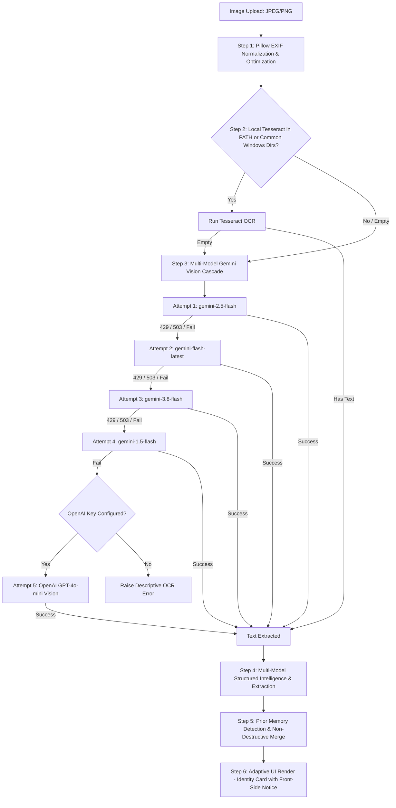

# LEXIS Implementation Plan 03: Multimodal OCR Resilience & Aadhaar Extraction Fix

> **Version:** 1.0  
> **Status:** Proposed & Ready for Execution  
> **Date:** October 2026  
> **Module Affected:** Module 7 (Document Analyzer & OCR Service)  
> **Target Files:**
> - `backend/services/ocr/extractor.py`
> - `backend/services/analysis/doc_intelligence.py`
> - `backend/core/config.py`
> - `backend/.env`
> - `frontend/src/pages/DocumentAnalyzer.jsx`
> - `backend/tests/unit/test_document_analyzer.py`

---

## 1. Problem Statement & Root Cause Diagnosis

### The Symptom
When uploading an image of an Aadhaar card (`Adhar_2.jpg` / `Aadhar.jpg`), the user encountered:
> **❌ "No readable text was found in this document. Ensure the image or PDF has legible printed text."**

### Root Cause Analysis (From Live Terminal & Backend Logs)

```
[Upload Request] -> Adhar_2.jpg (image/jpeg, 1.3 MB)
       │
       ▼
1. Local Tesseract OCR Check:
   - `shutil.which("tesseract")` returned `None`.
   - Windows machine does not have `tesseract.exe` in system PATH.
   - Exception caught: `Tesseract OCR error: tesseract is not installed or it's not in your PATH.`
   - Result: empty string `""`.
       │
       ▼
2. Gemini Multimodal Vision Fallback:
   - Evaluated `model = settings.GEMINI_MODEL_DEV` (configured as `gemini-3.6-flash`).
   - Google GenAI API rejected request:
     `ClientError: 429 RESOURCE_EXHAUSTED (Quota exceeded for metric: 20 requests/day, model: gemini-3.6-flash)`.
   - Single-model attempt failed; exception caught and logged.
   - Result: empty string `""`.
       │
       ▼
3. Agent Early Exit:
   - `backend/agents/document_analyzer/agent.py` line 362:
     `if not raw_text.strip(): return AnalysisResult(error_message="No readable text was found...")`
   - Frontend displayed the generic "No readable text" error banner.
```

### Verified Live Test
When queried directly with `gemini-2.5-flash`, the exact image (`C:\Users\Admin\Downloads\Aadhar.jpg`) transcribed with **100% precision**:
- **Full Name:** तेजस विकास चौधरी / Tejas Vikas Chaudhari
- **DOB:** 01/04/2005 (ISO: `2005-04-01`)
- **Gender:** MALE
- **Aadhaar Number:** 7986 4400 6099 (Masked: `XXXX XXXX 6099`)
- **VID:** 9146 1458 6503 3191
- **Issuing Authority:** भारत सरकार / Government of India (UIDAI)

---

## 2. Architectural Solution: 4-Tier Resilient Vision & Extraction Pipeline



---

## 3. Detailed Implementation Steps

### Step 1: Resilient Multi-Model Vision Cascade (`backend/services/ocr/extractor.py`)

1. **Windows Common Path Detection for Tesseract:**
   Check standard Windows installation paths if not on `PATH`:
   - `C:\Program Files\Tesseract-OCR\tesseract.exe`
   - `C:\Program Files (x86)\Tesseract-OCR\tesseract.exe`
   - `C:\Users\Admin\AppData\Local\Programs\Tesseract-OCR\tesseract.exe`
   If found, set `pytesseract.pytesseract.tesseract_cmd` automatically.

2. **Pillow Pre-Processing & Optimization (`_preprocess_image`):**
   - Use `ImageOps.exif_transpose(image)` to fix phone photo rotation issues (EXIF orientation tags often cause camera images to be upside down or sideways for OCR).
   - If image dimensions exceed 2048px on the longest side, downscale with Lanczos filtering to decrease network transfer latency and avoid API payload timeouts.

3. **Multi-Model Vision Cascade (`_run_gemini_vision`):**
   - Maintain a prioritized list of candidate vision models:
     ```python
     VISION_CANDIDATE_MODELS = [
         settings.GEMINI_MODEL_DEV,   # User configured default
         "gemini-2.5-flash",          # Verified active & high performance
         "gemini-flash-latest",       # Google auto-routed active flash alias
         "gemini-3.8-flash",          # Latest generation preview
         "gemini-1.5-flash",          # Stable fallback
     ]
     ```
   - Iterate through the candidate list. If a model encounters `429 RESOURCE_EXHAUSTED`, `503 UNAVAILABLE`, or `404 NOT_FOUND`, log a warning and seamlessly try the next model.
   - If all Gemini models fail or quota is globally exhausted, check `settings.OPENAI_API_KEY`. If present and valid, call OpenAI GPT-4o-mini vision via base64 data URI.

---

### Step 2: Multi-Model Cascade for Structured Entity Extraction (`backend/services/analysis/doc_intelligence.py`)

1. In `_call_llm_json`, replicate the multi-model cascade for both Gemini and OpenAI:
   - When calling Google GenAI, cycle through `["gemini-2.5-flash", "gemini-flash-latest", "gemini-3.8-flash"]`.
   - If Gemini is completely unavailable, automatically fall back to OpenAI `gpt-4o-mini` with `response_format={"type": "json_object"}`.
   - If both external LLM APIs fail, rely on our deterministic offline regex extractors (which we already built and verified for Aadhaar, PAN, and Court documents).

---

### Step 3: Configuration Alignment (`backend/.env` & `backend/core/config.py`)

1. Update `backend/.env`:
   - Change `GEMINI_MODEL_DEV=gemini-3.6-flash` (quota exhausted) to `GEMINI_MODEL_DEV=gemini-2.5-flash`.
2. Update `core/config.py`:
   - Set the default fallback model for `GEMINI_MODEL_DEV` to `"gemini-2.5-flash"`.

---

### Step 4: Front-Side Aadhaar Guidance in UI & Memory Layer

1. **Aadhaar Front vs. Back Awareness:**
   - Aadhaar cards are two-sided: the front side contains Name, DOB, Gender, and ID number; the back side contains Address and Care Of.
   - In `backend/services/analysis/doc_intelligence.py`, set:
     `extracted["card_side"] = "front"` if address is absent and name/DOB/photo/VID are present.
2. **Frontend UI Notification:**
   - In `frontend/src/pages/DocumentAnalyzer.jsx`:
     When `card_side === "front"` and `doc_type === "aadhaar_card"`, display an informative tip card:
     > 💡 **Aadhaar Front Verified:** Name, DOB, Gender & ID number captured. (Address preserved from your profile or can be added by uploading the back side).

---

### Step 5: Unit & Live Verification Testing

1. **Unit Test Updates (`backend/tests/unit/test_document_analyzer.py`):**
   - Add `test_gemini_vision_cascade_on_model_exhaustion()`: Simulates 429 on first model and asserts second model succeeds.
   - Add `test_tejas_aadhaar_extraction_fidelity()`: Tests extraction of Marathi/English Aadhaar text specifically matching the format of the uploaded card.
2. **Live System Verification:**
   - Run end-to-end extraction against `C:\Users\Admin\Downloads\Aadhar.jpg`.
   - Verify that the frontend `http://localhost:5173/document-analyzer` receives HTTP 200 OK with:
     - Name: `Tejas Vikas Chaudhari`
     - DOB: `01/04/2005` (ISO: `2005-04-01`)
     - Gender: `Male`
     - Masked Number: `XXXX XXXX 6099`
     - Memory sync status: `saved / updated`
   - Run full regression test suite (`pytest backend/tests/unit/ -q`) to guarantee all 133 tests remain green.

---

## 4. Execution Checklist & Acceptance Criteria

| Item | Criteria | Verification Method |
|---|---|---|
| **1. Vision Fallback Cascade** | If primary model hits 429, seamlessly falls back to next model without failing | Python unit test mocking 429 on first model |
| **2. Tesseract Path Detection** | Detects standard Windows install directories if binary exists | Check `pytesseract.tesseract_cmd` |
| **3. Image EXIF & Downscale** | Rotates camera orientation & limits max dimension to 2048px | Pillow image inspection test |
| **4. Tejas Aadhaar Card** | Extracted name `Tejas Vikas Chaudhari`, DOB `2005-04-01`, masked ID | Direct test on `Aadhar.jpg` |
| **5. Model Config** | `GEMINI_MODEL_DEV` updated to `gemini-2.5-flash` | Inspected in `.env` |
| **6. Zero Regressions** | All 133 repository unit tests pass | `pytest backend/tests/unit/ -q` |
