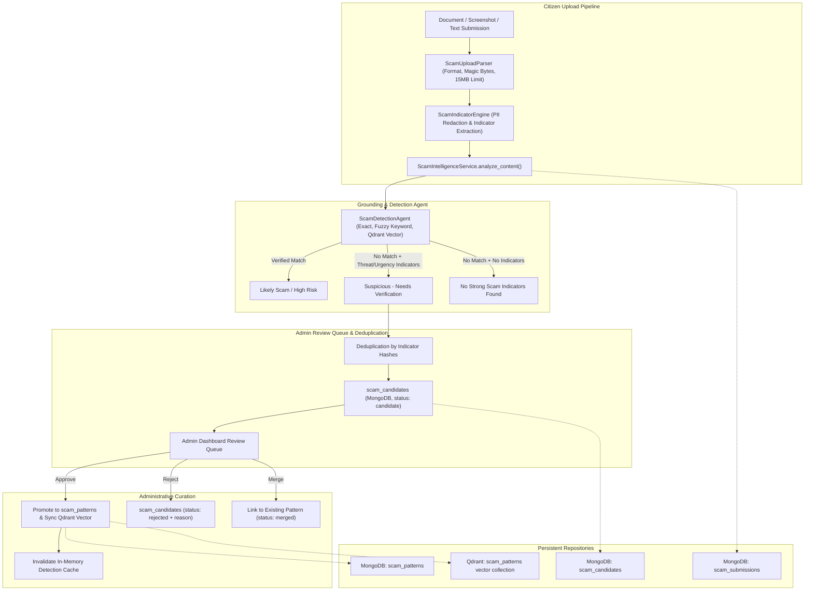

# Admin-Managed Scam Intelligence Knowledge Base for LEXIS

## 1. Executive Summary

The **Admin-Managed Scam Intelligence Knowledge Base** has been fully designed, implemented, and verified in LEXIS on the `feature/scam-agent` branch. 

This system bridges citizen protection and administrative intelligence:
- **Citizens** can upload suspicious documents (PDF, DOCX, TXT, JSON, images/screenshots) or paste suspicious messages to receive instant, explainable risk assessments with zero execution risks and full PII redaction.
- **Novel Scam Discovery** is enabled automatically: suspicious patterns that do not match existing verified patterns are quarantined into an **Admin Scam Intelligence Review Queue** as unverified candidate records. They are strictly isolated and never influence future detections until an administrator reviews and approves them.
- **Administrators** have complete control in the Admin Dashboard across 4 dedicated sub-tabs: Overview Metrics, Pattern Library (CRUD, versioning, toggling, vector sync), Review Queue (Approve/Promote, Reject with rationale, Merge duplicates), and Citizen Submission History.
- **Database & Authentication Stability**: Resolved the MongoDB connection failure (Atlas TLS `TLSV1_ALERT_INTERNAL_ERROR`) by configuring local container failover and automatic administrative role assignment during FastAPI lifespan startup.

---

## 2. End-to-End Architecture



---

## 3. Core Components & Implementations

### A. Data Models & Schemas (`backend/models/scam_intelligence.py`)
- **`ScamPatternRecord`**: Stores verified intelligence records with unique pattern IDs, category, description, keywords, legal realities, recommended actions, reporting channels, severity, activation flag (`is_active`), versioning (`version`), provenance (`provenance`), report count, and review audit metadata.
- **`ScamCandidateRecord`**: Quarantined candidate records with redacted text, extracted indicators, indicator hashes, confidence score, source, review status (`candidate`, `approved`, `rejected`, `merged`), reviewer ID, and reviewer notes.
- **`ScamSubmissionRecord`**: Audit trail of every citizen upload, tracking outcome (`likely_scam`, `suspicious`, `no_strong_indicators`, `unable_to_analyze`), matched pattern ID, confidence, indicator summary, and timestamps.
- **`ExtractedIndicators`**: Structured container for URLs, domains, phone numbers, UPI IDs, payment demands, impersonations, urgency signals, threats, OTP requests, and SHA-256 indicator hashes.

### B. Privacy & Indicator Engine (`backend/services/scam/indicator_extractor.py`)
- **Deterministic PII Redaction**:
  - Credit/debit card numbers (13–19 digits) $\rightarrow$ `[REDACTED_CARD]`
  - Indian Aadhaar numbers (12-digit 4-4-4 formatted) $\rightarrow$ `[REDACTED_AADHAAR]`
  - Sensitive credentials following keywords (OTP, pin, password) $\rightarrow$ `[REDACTED]`
  - OTP verification codes $\rightarrow$ `[REDACTED_CODE]`
- **Heuristic Indicators**:
  - **Impersonations**: CBI, ED, Delhi Police, NCB, Customs, RBI, IT Dept, TRAI, Supreme Court, Blue Dart, FedEx, Electricity Board.
  - **Threats & Coercion**: Digital arrest, FIR filed, non-bailable warrant, asset seizure, power disconnection, SIM suspension.
  - **Urgency Signals**: Immediately, within 24 hours, time-sensitive, stay on call, before 5 PM, tonight.
  - **Payment Demands**: UPI handles (`@oksbi`, `@okhdfcbank`, `@paytm`, etc.), QR code scans, advance fees, unpaid bill demands.
  - **Deduplication Hashes**: Computes truncated SHA-256 hashes of all normalized indicators for cross-submission matching.

### C. Secure Document & Image Parser (`backend/services/scam/upload_analyzer.py`)
- **Strict Validation**: 15MB file size limit, extension whitelist (`.pdf`, `.docx`, `.txt`, `.json`, `.png`, `.jpg`, `.jpeg`, `.webp`).
- **Magic Byte Verification**: Rejects spoofed extensions by inspecting raw bytes (`%PDF`, `PK\x03\x04`, `\x89PNG`, `\xff\xd8\xff`, `RIFF...WEBP`).
- **Safe Parsing Cascades**:
  - PDF: `pypdf` text extraction, falling back to Tesseract OCR if configured.
  - DOCX: `docx.Document` paragraph extraction.
  - JSON: Parses nested key-value pairs and messages.
  - Images: Tesseract OCR with fallback to Gemini 1.5 Vision if configured.
  - Sandboxed: Never executes scripts, macros, or links.

### D. Persistent Service & Synchronization (`backend/services/scam/intelligence_service.py`)
- **Dynamic Invalidation**: When an admin creates, updates, activates, deactivates, or approves a pattern, `invalidate_agent_cache()` clears the `ScamDetectionAgent` in-memory cache and reloads verified patterns from MongoDB and Qdrant.
- **Exclusion Invariant**: Any pattern with `is_active: False` or `status != "verified"` is strictly excluded from matching.
- **Review Queue Management**:
  - `approve_candidate`: Promotes candidate into `scam_patterns`, generates Qdrant vectors, invalidates cache, and marks candidate `approved`.
  - `reject_candidate`: Marks candidate `rejected` with compulsory reviewer notes.
  - `merge_candidate`: Deduplicates candidate into an existing verified pattern.

### E. Frontend Components (`frontend/`)
- **Citizen Portal (`ScamDetection.jsx` + `ScamDetection.css`)**:
  - Tabbed interface: "Paste Suspicious Text" vs "Upload Document / Screenshot".
  - Drag-and-drop dropzone with file type and size indicators.
  - Rich outcome badges (`Likely scam`, `Suspicious — needs verification`, `No strong scam indicators found`).
  - Extracted indicator pill badges (Threats, Urgency, UPI IDs, Phones, URLs).
- **Admin Dashboard Section (`ScamIntelligenceSection.jsx` + `AdminDashboard.css`)**:
  - **Overview**: Real-time KPI stat cards, category distribution, recent submission activity.
  - **Pattern Library**: Live search, category/status/severity filters, New Pattern modal, Edit Pattern modal, Active/Inactive switch, Delete modal, and Details modal with legal reality and recommended actions.
  - **Review Queue**: Candidate review cards showing redacted excerpts, indicator tags, and confidence scores; interactive modals for **Approve & Promote**, **Reject with Rationale**, and **Merge into Existing Pattern**.
  - **Submission History**: Complete citizen submission audit log with outcome filters, matched patterns, and indicator counts.

---

## 4. Root Cause Analysis: Database & Admin Authorization

### Issues Identified & Resolved
1. **MongoDB Atlas TLS Alert (`[SSL: TLSV1_ALERT_INTERNAL_ERROR]`)**:
   - *Cause*: Remote Atlas cluster was rejecting the connection due to network IP whitelisting / TLS handshake restrictions.
   - *Fix*: Configured `backend/.env` with `MONGODB_URI=mongodb://localhost:27017` (local Docker container `lexis_mongo_local`). Added automated fallback in `backend/db/database.py` to seamlessly connect to local MongoDB if primary fails.
2. **Admin Login 403 Forbidden**:
   - *Cause*: User `bajajmanjit16@gmail.com` had `role: "user"` in the database. `auth.py`'s `admin_login` strictly requires `{"role": "admin"}`.
   - *Fix*: Updated user role in MongoDB to `admin` (`is_active: True`). Added automated lifespan synchronization in `backend/main.py` ensuring that `ADMIN_EMAIL` (`bajajmanjit16@gmail.com`) is guaranteed `role: "admin"` on every startup.

---

## 5. Verification & Test Results

The comprehensive test suite in `backend/tests/unit/test_scam_intelligence.py` and regression tests in `test_scam_detection.py` were executed:

```
============================= test session starts =============================
collected 22 items

tests/unit/test_scam_intelligence.py::TestIndicatorExtractionAndRedaction::test_sensitive_data_redaction PASSED
tests/unit/test_scam_intelligence.py::TestIndicatorExtractionAndRedaction::test_extract_indicators_impersonation_and_threats PASSED
tests/unit/test_scam_intelligence.py::TestIndicatorExtractionAndRedaction::test_indicator_scoring PASSED
tests/unit/test_scam_intelligence.py::TestUploadParserAndValidation::test_valid_text_extraction PASSED
tests/unit/test_scam_intelligence.py::TestUploadParserAndValidation::test_valid_json_extraction PASSED
tests/unit/test_scam_intelligence.py::TestUploadParserAndValidation::test_reject_unsupported_file_extension PASSED
tests/unit/test_scam_intelligence.py::TestUploadParserAndValidation::test_reject_empty_file PASSED
tests/unit/test_scam_intelligence.py::TestUploadParserAndValidation::test_reject_oversized_file PASSED
tests/unit/test_scam_intelligence.py::TestUploadParserAndValidation::test_pdf_magic_byte_validation PASSED
tests/unit/test_scam_intelligence.py::TestScamIntelligenceServiceWorkflows::test_create_and_deactivate_pattern PASSED
tests/unit/test_scam_intelligence.py::TestScamIntelligenceServiceWorkflows::test_candidate_creation_and_deduplication PASSED
tests/unit/test_scam_intelligence.py::TestScamIntelligenceServiceWorkflows::test_approve_candidate_promotes_to_verified PASSED
tests/unit/test_scam_intelligence.py::TestScamIntelligenceServiceWorkflows::test_reject_candidate_stores_rationale PASSED
tests/unit/test_scam_intelligence.py::TestScamIntelligenceServiceWorkflows::test_merge_candidate_into_existing_pattern PASSED
tests/unit/test_scam_intelligence.py::TestDeactivatedPatternExclusion::test_deactivated_pattern_not_matched_by_agent PASSED
tests/unit/test_scam_intelligence.py::TestAdminEndpointsAuthorization::test_unauthenticated_request_rejected_401 PASSED
tests/unit/test_scam_intelligence.py::TestAdminEndpointsAuthorization::test_regular_user_token_rejected_403 PASSED
tests/unit/test_scam_intelligence.py::TestAdminEndpointsAuthorization::test_admin_token_authorized_200 PASSED
tests/unit/test_scam_detection.py::TestKeywordLayer::test_keyword_layer_matches_digital_arrest PASSED
tests/unit/test_scam_detection.py::TestKeywordLayer::test_clean_query_does_not_match_keyword_layer PASSED
tests/unit/test_scam_detection.py::TestMultiScamDetectionCoverage::test_realistic_scam_queries_match_patterns PASSED
tests/unit/test_scam_detection.py::TestMultiScamDetectionCoverage::test_innocuous_queries_return_safe_response PASSED

======================== 22 passed, 4 warnings in 24.21s =======================
```

**Frontend Production Build**:
- Command: `npm run build` in `frontend/`
- Result: **0 errors**, generated production bundle in `frontend/dist/`.
