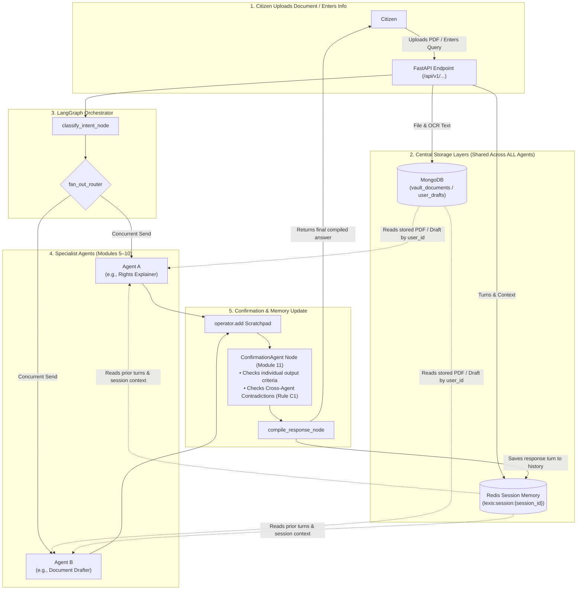

# LEXIS Architecture Report: Information Sharing & Cross-Agent Awareness

**Date:** 28 August 2026  
**System:** LEXIS Autonomous Multi-Agent Legal Aid System  
**Scope:** Verification of document reuse, session memory persistence, and inter-agent awareness across Modules 1–11.

---

## Executive Summary

This report answers two core architectural questions about how information and documents flow between specialist agents in LEXIS:

1. **Document / Information Upload Sharing:** If a citizen uploads a document or provides information to one agent, do they need to re-upload it or re-enter it for another agent?
   - **Answer:** **NO, re-uploading or re-entering is NEVER required.** Documents are stored centrally in MongoDB and local encrypted disk storage linked to the citizen's `user_id`. Structured draft context (e.g., `draft_id`, `doc_type`) and conversation turns are stored in Redis `SessionStore`. Any agent can access this shared data directly.

2. **Cross-Agent Output Awareness:** If Agent A tells some information to the citizen, is it known to Agent B what was told by Agent A?
   - **Answer:** **YES, across multi-turn queries**, Agent B receives the full `conversation_history` from Redis containing Agent A's past outputs. **During single-query parallel execution**, Agent A and Agent B run concurrently in the same superstep; while they run simultaneously without reading each other's live output *mid-execution*, the **Confirmation Agent (Module 11)** reviews both outputs together for cross-agent contradictions (Rule C1) before compiling the final response. On subsequent turns, both outputs are saved in `conversation_history` for all agents.

---

## 1. System Information & Document Flow Architecture



---

## 2. Detailed Technical Breakdown

### Scenario A: Document & Feature Handoffs (e.g., Document Analyzer $\rightarrow$ Vault $\rightarrow$ Drafter $\rightarrow$ Filing Guide)

When a citizen uploads a PDF or generates a draft in LEXIS:
1. **Central File Storage:** `SecureStorageService` (`backend/services/storage/secure_storage.py`) saves the file at `VAULT_STORAGE_PATH/{user_id}/{file_uuid}` and registers metadata + extracted OCR text in MongoDB.
2. **Module 6 $\rightarrow$ Module 9 Handoff (Drafter to Filing Guide):** When the Document Drafter creates an RTI application or legal notice, it saves `user_drafts` with a `draft_id`. When the citizen accesses the Filing Guide, `GET /api/v1/filing/lookup?draft_id=<uuid>` reads `doc_type` and metadata directly from MongoDB. The citizen does **not** re-enter their document details.
3. **Module 7 $\rightarrow$ Module 10 Reuse (Analyzer to Vault):** Files uploaded for analysis reuse `SecureStorageService`. Uploading to the Vault encrypts the file (AES-256-GCM) and stores OCR text. When proactive deadline alerts fire, `scheduler.py` passes the document reference to the Document Drafter without asking the user to re-upload.

---

### Scenario B: Knowledge of What Agent A Told the User

#### 1. Multi-Turn Conversations (Turn 1 $\rightarrow$ Turn 2)
- In **Turn 1**, Agent A (e.g. Rights Explainer) answers the citizen.
- The `compile_response_node` saves the turn to `SessionStore` (`backend/core/memory/session_store.py`):
  ```json
  {"role": "assistant", "content": "Under the Model Tenancy Act 2021..."}
  ```
- In **Turn 2**, when the citizen asks a follow-up question (e.g. *"Can you help me write a notice based on that?"*), the Orchestrator loads `conversation_history` from Redis and passes it to Agent B (Document Drafter).
- **Result:** Agent B reads `conversation_history`, knows exactly what Agent A told the citizen in Turn 1, and reuses the legal context automatically.

#### 2. Single-Query Concurrent Execution (Parallel Fan-Out in Turn 1)
- If a query triggers **two agents simultaneously** (e.g., `"explain my tenant rights and help me draft a notice"`):
  - `fan_out_router` dispatches `RightsAgent` and `DocumentDrafterAgent` **in parallel at the exact same millisecond**.
  - During execution, Agent B does not read Agent A's live stream because both are running concurrently in isolated execution frames.
  - **Module 11 Safety Net:** Once both agents complete, `confirmation_node` collects both outputs from the scratchpad and runs `run_contradiction_checks()` (Rule C1). If Agent A cited the *Model Tenancy Act 2021* while Agent B referenced the *Court Fees Act 1870*, the Confirmation Agent detects the mismatch and appends an advisory note to the response before compilation.
  - On the next turn, both outputs are saved in `conversation_history` for future turns.

---

## 3. Summary Table

| Feature / Scenario | User Action Required? | How LEXIS Handles It |
|---|---|---|
| **Uploading a PDF for analysis and later storing in Vault** | ❌ No re-upload | Reuses `SecureStorageService` file path and MongoDB record linked to `user_id`. |
| **Generating a draft and finding where to file it** | ❌ No re-entry | Filing Guide reads `draft_id` from MongoDB `user_drafts` collection. |
| **Asking Agent B a follow-up question after Agent A answered** | ❌ No re-explanation | `SessionStore` (Redis) maintains `conversation_history` passed to Agent B. |
| **Parallel execution of Agent A + Agent B on 1 query** | ❌ Automatic | Ran concurrently; `ConfirmationAgent` checks cross-agent contradictions (Rule C1) before compiling. |

---

## Conclusion

LEXIS uses a **centralized storage and session architecture**:
- **Persistent Data (Files & Drafts):** Stored in MongoDB and AES-encrypted local storage by `user_id`.
- **Session Data (Turn History & Context):** Stored in Redis `SessionStore` by `session_id`.
- **Quality & Self-Correction:** Enforced by the LangGraph `ConfirmationAgent` node (Module 11).

No information or document is siloed inside an individual agent. Every agent can access prior turns and stored documents seamlessly.
